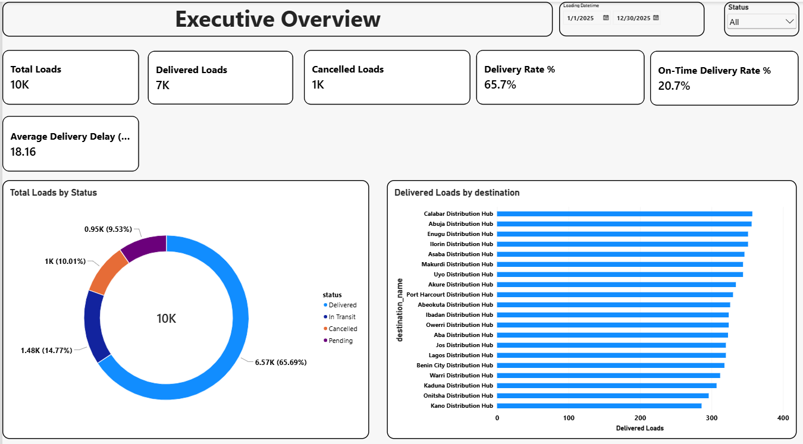
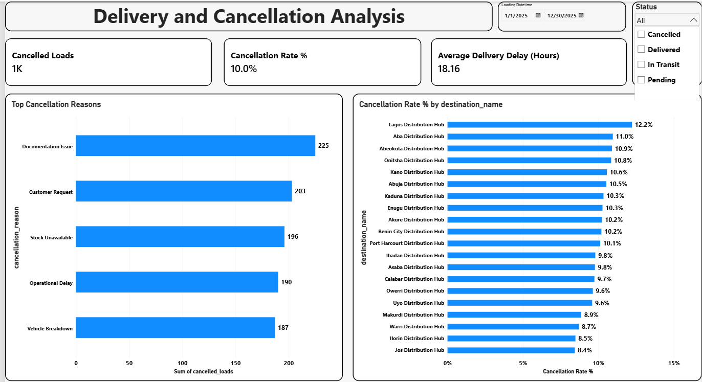
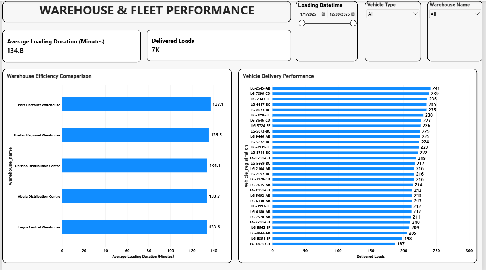
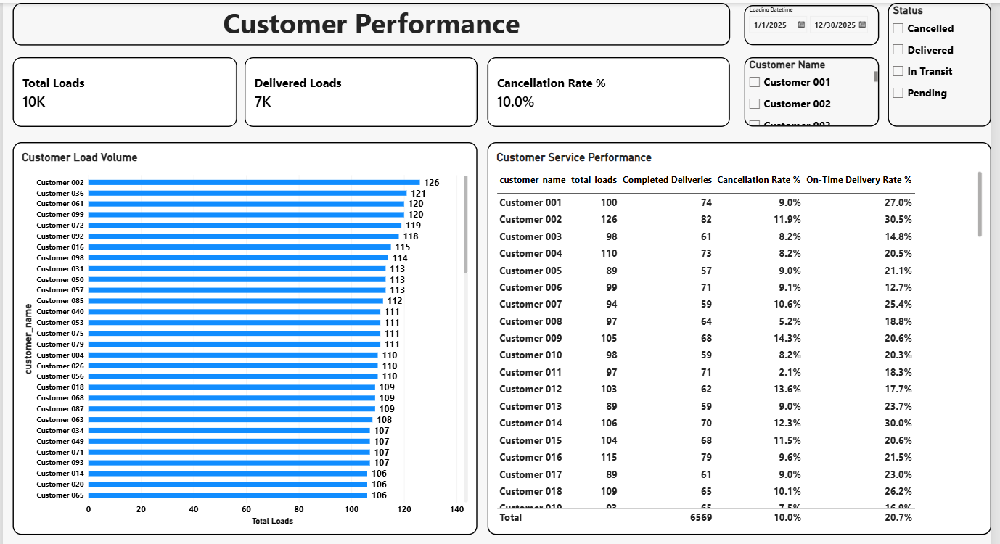

# LogiFlow Logistics Analytics Engineering

**Building reliable, tested analytical data models with PostgreSQL, dbt, Python, and Power BI.**

LogiFlow is an end-to-end analytics engineering portfolio project that transforms raw logistics operational data into structured, tested, and business-ready analytical datasets. The project demonstrates relational data modeling, SQL transformations, data quality testing, analytical marts, and interactive business intelligence reporting.

The goal is to demonstrate how analytics engineers can bridge the gap between raw operational data and reliable business insights.

> **Data disclaimer:** This project uses synthetic data generated for demonstration and portfolio purposes. Reported metrics and findings do not represent the actual performance of a real logistics company.

---

## Table of Contents

- [Project Overview](#project-overview)
- [Business Problem](#business-problem)
- [Project Objectives](#project-objectives)
- [Technology Stack](#technology-stack)
- [Architecture and Data Flow](#architecture-and-data-flow)
- [Source Data and Data Model](#source-data-and-data-model)
- [Analytics Engineering with dbt](#analytics-engineering-with-dbt)
- [Data Quality and Testing](#data-quality-and-testing)
- [Power BI Dashboard](#power-bi-dashboard)
- [Key Performance Indicators](#key-performance-indicators)
- [Illustrative Findings](#illustrative-findings)
- [Repository Structure](#repository-structure)
- [Getting Started](#getting-started)
- [Security and Configuration](#security-and-configuration)
- [Skills Demonstrated](#skills-demonstrated)
- [Future Improvements](#future-improvements)
- [Author](#author)

---

## Project Overview

Logistics businesses generate operational data throughout the order fulfillment and delivery lifecycle. However, raw records are not automatically suitable for reporting, performance monitoring, or business decision-making.

LogiFlow demonstrates an analytics engineering workflow that organizes operational data into reliable analytical models and reporting datasets.

The project uses Python to generate synthetic data, PostgreSQL to store relational records, dbt Core to transform and test the data, and Power BI to visualize operational performance.

The current implementation includes:

- 11 operational source tables.
- 10,000 load records.
- 11 dbt staging models.
- 16 dbt mart-layer models, including fact tables, dimension tables, and reporting marts.
- 52 passing dbt tests.
- Five business-focused reporting marts.
- A four-page Power BI dashboard.

## Business Problem

Raw logistics records can make it difficult for decision-makers to answer important operational questions consistently.

Examples include:

- What proportion of loads are delivered, cancelled, or still in progress?
- What percentage of completed deliveries arrive on time?
- Which cancellation reasons occur most frequently?
- Which destinations experience weaker delivery performance?
- How efficiently do warehouses process loads?
- How does delivery performance vary across vehicles and customers?
- How can business teams access consistent, reusable metrics instead of calculating them separately in multiple reports?

LogiFlow addresses these questions by building a structured data transformation layer that converts operational records into reusable analytical datasets.

## Project Objectives

1. Design and maintain a relational model for logistics operations.
2. Generate and validate synthetic operational data.
3. Transform raw source tables into clean, standardized staging models.
4. Build fact tables, dimension tables, and reporting marts using dbt.
5. Implement automated data quality tests and business-rule validation.
6. Prepare reusable datasets for business intelligence reporting.
7. Develop an interactive Power BI dashboard for operational monitoring.
8. Document the transformation logic, data model, and business meaning of key metrics.

---

## Technology Stack

| Technology | Role in the project |
|---|---|
| Python | Synthetic data generation and data validation |
| PostgreSQL | Relational database and SQL execution |
| Supabase | Hosted PostgreSQL database |
| dbt Core | SQL transformations, model organization, and data testing |
| Power BI Desktop | Data visualization, DAX measures, and interactive reporting |
| Git | Version control |
| GitHub | Source code hosting and project documentation |

---

## Architecture and Data Flow

The project follows a layered data workflow.

```text
Python Synthetic Data Generator
              |
              v
    PostgreSQL / Supabase
       Raw Source Tables
              |
              v
      dbt Staging Layer
    Standardized SQL Models
              |
              v
      dbt Mart Layer
  Facts, Dimensions and Marts
              |
              v
       Power BI Desktop
   KPI Measures and Reports
              |
              v
      Business Insights
```

### Layer 1: Data Generation

Python scripts generate synthetic logistics records across operational entities, including loads, customers, products, vehicles, drivers, warehouses, destinations, and deliveries.

### Layer 2: Data Storage

PostgreSQL stores the generated records in relational tables with primary keys, foreign keys, and defined relationships.

Supabase provides the hosted PostgreSQL environment used by the project.

### Layer 3: Staging Transformations

dbt staging models standardize the raw source tables and provide a consistent foundation for downstream transformations.

### Layer 4: Analytical Modeling

The dbt mart layer contains fact tables, dimension tables, and aggregate reporting marts. These models prepare the data for consistent business analysis.

### Layer 5: Business Intelligence

Power BI connects to the PostgreSQL environment and consumes the analytical datasets to deliver KPI cards, charts, tables, and interactive slicers.

---

## Source Data and Data Model

The source database contains 11 operational tables.

| Source table | Business purpose |
|---|---|
| `loads` | Load records, operational statuses, and timestamps |
| `load_items` | Products and quantities associated with loads |
| `deliveries` | Delivery records and outcomes |
| `customers` | Customer information |
| `products` | Product information |
| `destinations` | Delivery destination information |
| `vehicles` | Fleet and vehicle records |
| `drivers` | Driver information |
| `warehouses` | Warehouse information |
| `loading_officers` | Loading officer records |
| `cancellation_reasons` | Categorized reasons for cancelled loads |

The `loads` table contains 10,000 records. Other source tables contain the associated entities and operational transactions.

The relational model supports analysis across load status, delivery performance, cancellation reasons, loading operations, fleet utilization, and customer activity.

---

## Analytics Engineering with dbt

The dbt project separates source preparation from downstream analytical models.

### 1. Staging Models

The staging layer contains 11 models:

- `stg_loads`
- `stg_load_items`
- `stg_deliveries`
- `stg_customers`
- `stg_products`
- `stg_destinations`
- `stg_drivers`
- `stg_warehouses`
- `stg_loading_officers`
- `stg_cancellation_reasons`
- `stg_vehicles`

These models reference the raw PostgreSQL tables through dbt source definitions.

Staging models are materialized as views, providing a consistent transformation layer without unnecessarily duplicating the raw records.

### 2. Fact and Dimension Models

The project includes the following core analytical models.

**Fact tables**

- `fct_loads`
- `fct_load_items`
- `fct_deliveries`

**Dimension tables**

- `dim_customers`
- `dim_products`
- `dim_vehicles`
- `dim_drivers`
- `dim_cancellation_reasons`
- `dim_destinations`
- `dim_loading_officers`
- `dim_warehouses`

These models organize operational data into structures that support reusable analysis and reporting.

The `fct_loads` model includes derived metrics and indicators such as:

- Loading duration in minutes.
- Delivery delay in hours.
- Delivered-load indicator.
- Cancelled-load indicator.
- On-time delivery indicator.

The delivery, cancellation, and on-time indicators are represented as integer flags in the current implementation.

### 3. Reporting Marts

Five reporting marts support the Power BI dashboard.

| Model | Purpose |
|---|---|
| `mart_delivery_performance_by_destination` | Compares delivery performance across destinations |
| `mart_cancellation_analysis` | Examines cancellation patterns and reasons |
| `mart_warehouse_efficiency` | Evaluates warehouse loading performance |
| `mart_vehicle_performance` | Supports vehicle-level performance analysis |
| `mart_customer_performance` | Summarizes customer activity and service outcomes |

The mart layer is materialized as tables to provide reporting-ready datasets for downstream consumption.

### 4. Transformation Design

The project uses dbt model dependencies and source references to organize the transformation workflow.

The completed implementation separates raw operational data from staging transformations and downstream reporting models, helping make business logic easier to inspect, test, and maintain.

---

## Data Quality and Testing

Data quality is a core component of the project.

The dbt test suite includes checks for:

- Unique identifiers.
- Non-null required fields.
- Referential integrity between related models.
- Accepted load-status values.
- Required cancellation and warehouse identifiers in applicable reporting models.
- Key integrity in the reporting marts.

Additional validation checks were used to examine:

- Orphaned foreign keys.
- Cancelled loads without cancellation reasons.
- Delivery records associated with nonexistent loads.
- Delivery records for loads that were not delivered.
- Invalid or non-positive load-item quantities.
- Inconsistent loading and delivery timestamps.

### Validation Results

| Validation item | Result |
|---|---:|
| Staging models built successfully | 11 of 11 |
| Mart-layer models built successfully | 16 of 16 |
| dbt tests passed | 52 |
| dbt test warnings | 0 |
| dbt test errors | 0 |
| Load records | 10,000 |

These results reflect the completed local dbt execution and testing run.

Data quality testing helps identify issues early and increases confidence that downstream dashboards are built on consistent analytical models.

---

## Power BI Dashboard

Power BI provides the business-facing reporting layer of the project.

The report contains four pages designed to answer different operational questions.

### Page 1: Executive Overview

Provides a summary of overall logistics performance.

Key visuals include:

- Total loads.
- Delivered loads.
- Cancelled loads.
- Delivery rate.
- On-time delivery rate.
- Average delivery delay.
- Load-status distribution.
- Delivery performance by destination.

**Business purpose:** Provide a high-level view of operations and identify areas requiring further investigation.

### Page 2: Delivery and Cancellation Analysis

Focuses on delivery outcomes and cancellation patterns.

Key analysis includes:

- Cancellation reasons.
- Cancellation counts and rates.
- Delivery delay.
- Delivery and cancellation KPIs.
- Filtering by relevant operational attributes.

**Business purpose:** Help identify recurring cancellation patterns and investigate delivery performance issues.

### Page 3: Warehouse and Fleet Performance

Examines warehouse processing and vehicle-level delivery performance.

Key analysis includes:

- Average loading duration by warehouse.
- Delivered-load volume by vehicle.
- Warehouse efficiency indicators.
- Fleet performance comparisons.
- Applicable warehouse, vehicle, and date filters.

**Business purpose:** Compare operational performance across facilities and vehicles to identify potential improvement opportunities.

### Page 4: Customer Performance

Examines customer activity and service outcomes.

Key analysis includes:

- Top 10 customers by load volume.
- Customer-level load activity.
- Completed deliveries.
- Cancellation rates.
- Customer and load-status filters.

**Business purpose:** Understand customer activity and identify differences in service performance.

### Dashboard Interactivity

The report uses slicers to filter relevant KPIs and visuals. KPI measures are defined using DAX, with denominator logic selected to match each metric's business meaning.

The Power BI report complements the dbt project: dbt prepares reusable analytical datasets, while Power BI makes the results accessible to business users.

### Dashboard Screenshots

Dashboard screenshots can be added to the repository under `docs/images/`.

Once the images have been saved, the following Markdown can be used to display them directly on GitHub.

#### Executive Overview



#### Delivery and Cancellation Analysis



#### Warehouse and Fleet Performance



#### Customer Performance



---

## Key Performance Indicators

The dashboard uses DAX measures to calculate and present operational metrics.

| KPI | Definition |
|---|---|
| Total Loads | Distinct count of load records |
| Delivered Loads | Loads classified as delivered |
| Cancelled Loads | Loads classified as cancelled |
| Delivery Rate | Delivered loads divided by total loads |
| Cancellation Rate | Cancelled loads divided by total loads |
| Completed Deliveries | Delivered loads with a recorded actual delivery timestamp |
| On-Time Deliveries | Completed deliveries classified as on time |
| On-Time Delivery Rate | On-time deliveries divided by completed deliveries |
| Average Loading Duration | Average loading duration in minutes |
| Average Delivery Delay | Average delivery delay in hours among completed deliveries with a valid delay value |

The on-time delivery rate uses completed deliveries as its denominator, rather than all loads. This distinction makes the metric more meaningful when evaluating punctuality among completed deliveries.

---

## Illustrative Findings

The current synthetic-data dashboard snapshot reports:

| Metric | Illustrative result |
|---|---:|
| Delivery Rate | 65.7% |
| On-Time Delivery Rate | 20.7% |
| Average Delivery Delay | 18.16 hours |

These figures demonstrate how the dashboard can highlight operational patterns that warrant further analysis.

For example, the on-time delivery rate and average delay can motivate investigation into performance by destination, loading duration, vehicle, or other available operational attributes.

The figures are based on synthetic data and should not be interpreted as real-world industry benchmarks or actual company performance.

---

## Repository Structure

The repository includes the synthetic data-generation assets, database schema and data assets, dbt project, and project documentation.

The following is a simplified overview. Additional scripts, data files, and configuration files may be present.

```text
logiflow-logistics-analytics/
│
├── data/
│   └── raw/
│
├── logiflow_dbt/
│   ├── models/
│   │   ├── staging/
│   │   │   ├── sources.yml
│   │   │   ├── staging.yml
│   │   │   └── staging SQL models
│   │   │
│   │   └── marts/
│   │       ├── fact and dimension models
│   │       ├── reporting mart models
│   │       └── marts.yml
│   │
│   ├── dbt_project.yml
│   └── ...
│
├── docs/
│   └── images/
│
├── README.md
└── ...
```

---

## Getting Started

The following steps describe the general workflow for exploring and running the project.

### Prerequisites

Install or configure:

- Python.
- PostgreSQL access.
- dbt Core with the PostgreSQL adapter.
- Git.
- Power BI Desktop, if you want to explore the dashboard.

### 1. Clone the repository

```bash
git clone https://github.com/CollinsOrji/logiflow-logistics-analytics.git
cd logiflow-logistics-analytics
```

### 2. Configure the Python environment

Create and activate a virtual environment using your preferred Python environment setup.

For example, on Windows PowerShell:

```powershell
python -m venv .venv
.\.venv\Scripts\Activate.ps1
```

Install the dependencies listed in the project's dependency file, if one is provided.

### 3. Configure PostgreSQL and dbt

Configure a PostgreSQL connection for the project and ensure that the dbt profile matches the project's profile name.

The dbt project directory is:

```text
logiflow_dbt/
```

The configured profile is:

```text
logiflow_dbt
```

Database credentials should be stored in a local dbt profile or another secure configuration mechanism rather than committed to GitHub.

### 4. Validate the dbt project

From the repository root, run:

```powershell
dbt debug --project-dir ".\logiflow_dbt"
```

Then execute the staging models:

```powershell
dbt run --project-dir ".\logiflow_dbt" --select staging
```

Execute the complete transformation project:

```powershell
dbt run --project-dir ".\logiflow_dbt"
```

Run the tests:

```powershell
dbt test --project-dir ".\logiflow_dbt"
```

These commands require a working database connection and the necessary source tables to be available. The successful results documented above reflect the existing development environment; a fresh setup must be configured before the commands can run successfully.

### 5. Explore the Power BI dashboard

Open the Power BI report file if it has been included in the repository.

If the report file is not included, review the dashboard screenshots in `docs/images/` and the documented KPI definitions.

A database connection may be required to refresh or interact with the original report.

---

## Security and Configuration

Database credentials and connection details must be handled securely.

- Do not commit passwords, API keys, access tokens, or private connection strings.
- Keep local dbt profiles outside the repository.
- Exclude local secrets and environment-specific configuration files from version control.
- Use environment variables or an approved secret-management mechanism where appropriate.
- Review staged files before committing changes.

Example Git review commands:

```bash
git status
git diff --cached
```

---

## Skills Demonstrated

This project demonstrates practical experience with:

### Analytics Engineering

- SQL-based transformations.
- Modular dbt model organization.
- Staging, fact, dimension, and reporting models.
- Data quality testing.
- Reusable business logic.
- Analytical dataset design.

### Data Management

- PostgreSQL.
- Relational schema design.
- Primary and foreign key relationships.
- Data integrity validation.
- Hosted database connectivity.

### Business Intelligence

- Power BI dashboard development.
- DAX measures.
- KPI definition.
- Interactive filtering.
- Operational performance analysis.
- Business-focused data storytelling.

### Development Practices

- Python scripting.
- Git and GitHub.
- Project documentation.
- Reproducible setup guidance.
- Separation of application code and credentials.

---

## Future Improvements

The next development stages will focus on strengthening the project's engineering practices.

- Expand dbt model and column documentation.
- Generate and publish dbt documentation and model lineage.
- Add a dedicated intermediate transformation layer where it improves reuse and clarity.
- Introduce automated dbt validation through GitHub Actions.
- Add repeatable dependency installation and environment setup instructions.
- Improve time-based reporting models for trend analysis.
- Evaluate query performance and incremental processing where justified.
- Add a documented data dictionary and architecture diagram.
- Explore delivery-delay risk analysis as a separate extension.

These improvements will be incorporated as they are implemented and validated.

---

## Author

**Collins Orji**

Analytics Engineering | Business Intelligence | SQL | PostgreSQL | dbt | Python | Power BI

GitHub: [CollinsOrji](https://github.com/CollinsOrji)

---

*LogiFlow is a portfolio project for demonstrating analytics engineering, data transformation, data quality, and business intelligence practices using synthetic logistics data.*